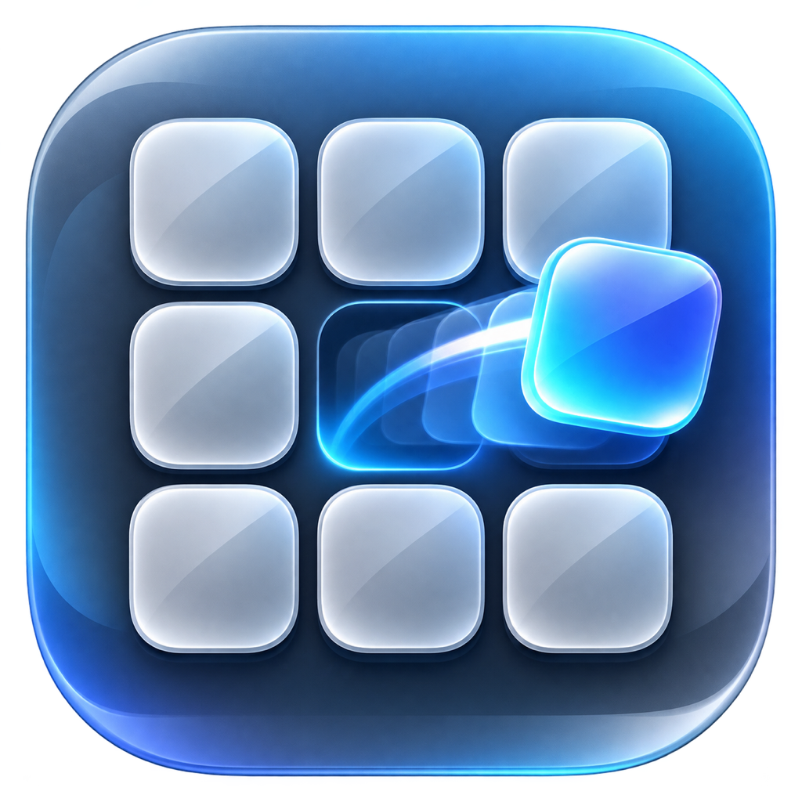

# CopyDock



CopyDock is a local-first macOS clipboard utility with nine stable, visual slots. Copy several things once, then paste or drag each one wherever it belongs—without keeping a permanent clipboard history.

Version 0.6.0 is the first release under the CopyDock name. CopyDock requires macOS 13 Ventura or later and currently ships as an Apple-silicon build.

## What it does

- Stores exactly nine in-memory clipboard slots—never an unlimited history.
- `Command-C`, then `1`–`9` while Command is still held, copies into that slot.
- Plain `Command-C` updates slot 1 and marks it as the most recently copied slot.
- `Command-V`, then `1`–`9` while Command is still held, pastes from that slot.
- Plain `Command-V` remains the normal macOS paste command.
- `Command-Shift-Space` shows or hides the inventory without Accessibility permission.
- Accepts drag-and-drop text, rich text, images, Finder files, and file promises.
- Drags stored content back into compatible applications.
- Shows content-first previews after a one-second hover, including image thumbnails and native file icons.
- Snaps to the top, bottom, left, or right screen edge.
- Includes adjustable colors, palettes, slot size, opacity, preview bounds, and background style.
- Keeps clipboard contents in memory and contains no network, account, analytics, or telemetry code.

## Install a shared build

CopyDock is not yet Developer ID signed or notarized. A friend can still run an ad-hoc-signed build:

1. Download and unzip `CopyDock-0.6.0.zip` from the matching GitHub release.
2. Move `CopyDock.app` to Applications.
3. Control-click the app, choose **Open**, and confirm the first launch.
4. When prompted, allow CopyDock in **System Settings → Privacy & Security → Accessibility**. This permission is needed only for numbered copy/paste interception and automatic paste.

Do not bypass macOS security prompts for a build obtained from anyone you do not trust. For wider distribution, use a Developer ID certificate and notarization.

## Use CopyDock

| Action | Keyboard or pointer |
| --- | --- |
| Show or hide the dock | `Command-Shift-Space` |
| Copy into slot 1 | `Command-C` |
| Copy into a chosen slot | Hold Command, press `C`, then `1`–`9` |
| Normal paste | `Command-V` |
| Paste a chosen slot | Hold Command, press `V`, then `1`–`9` |
| Store by dragging | Drag content or files onto a slot |
| Use by dragging | Drag a populated slot into another app |
| Move the dock | Drag its background toward a screen edge |
| Open Settings | Gear button, menu-bar item, Dock menu, or `Command-,` |
| Clear all slots | Trash button or menu-bar item |

The literal `Command-V` chord is held briefly until either a number is pressed or Command is released. This makes `Command-V-Number` possible without first pasting the ordinary clipboard. Numbered paste temporarily replaces the system pasteboard, sends the standard paste keystroke, then restores the previous clipboard after 350 milliseconds.

## Supported content

- Plain text, RTF, HTML, common image representations, file URLs, and multi-item clipboard data.
- PNG, JPEG, TIFF, HEIC, GIF, BMP, WebP, JPEG 2000, ICO, ICNS, and AVIF file references, subject to the installed macOS ImageIO support.
- PDF, Word, Excel, PowerPoint, audio, video, archives, folders, and other Finder items as file references with native icons.
- Lazy file promises from apps that support the macOS file-promise API.

CopyDock preserves every representation supplied by the source app within the configured per-item memory limit. Proprietary app-only formats and direct audio/video clipboard payloads may paste only into compatible apps. Password-manager and transient pasteboard types are intentionally excluded.

## Build from source

Requirements:

- macOS 13 or later
- Swift 6 toolchain / Xcode 16 or compatible Command Line Tools

Run a debug build:

```sh
swift run CopyDock
```

Run automated checks:

```sh
swift run CopyDockChecks
swift run CopyDock --self-check-preview
```

Create an ad-hoc-signed application bundle:

```sh
./scripts/build-app.sh
open dist/CopyDock.app
```

The script produces local-development output. See [Releasing](docs/RELEASING.md) for validation, packaging, signing, and notarization guidance.

## Privacy and security

CopyDock does not persist slot contents, send network requests, or collect telemetry. Settings are stored locally with macOS preferences. Temporary files materialized from drag-and-drop file promises are deleted when their slot is replaced or cleared, on normal quit, and on the next launch after an abnormal termination.

Read [Privacy](docs/PRIVACY.md) for the full data model and [Security](SECURITY.md) for responsible disclosure. Operational safeguards are inspired by Maccy's conservative clipboard handling; CopyDock is an independent implementation and does not include Maccy source code. See [Third-party notices](THIRD_PARTY_NOTICES.md).

## Troubleshooting

If shortcuts do not work, click **Enable Shortcuts** in the inventory and confirm CopyDock is enabled in Accessibility settings. Drag-and-drop and the menu-bar controls remain usable without that permission. See [Troubleshooting](docs/TROUBLESHOOTING.md) for permission resets, hard reset, compatibility notes, and diagnostics.

## Project structure

```text
Sources/CopyDock/       macOS UI, shortcuts, drag/drop, app lifecycle
Sources/CopyDockCore/   clipboard snapshots, privacy filter, nine-slot store
Checks/                 lightweight integration checks
Assets/                 app icon sources
Support/                application bundle metadata
scripts/                repeatable packaging tools
docs/                   privacy, architecture, troubleshooting, releasing
```

See [Architecture](docs/ARCHITECTURE.md) for the event and clipboard flow. Contributions are welcome through [CONTRIBUTING.md](CONTRIBUTING.md).

## Current limitations

- The shared build is not yet notarized and is Apple silicon only.
- Accessibility permission is required for numbered keyboard shortcuts.
- Some applications read the pasteboard later than CopyDock's 350 ms restore window.
- The app does not yet include launch-at-login, plain-text-only paste, editable slot labels, VoiceOver-complete keyboard navigation, or encrypted export/import.
- Slot contents intentionally disappear when CopyDock quits.

## License

CopyDock is available under the [MIT License](LICENSE).
